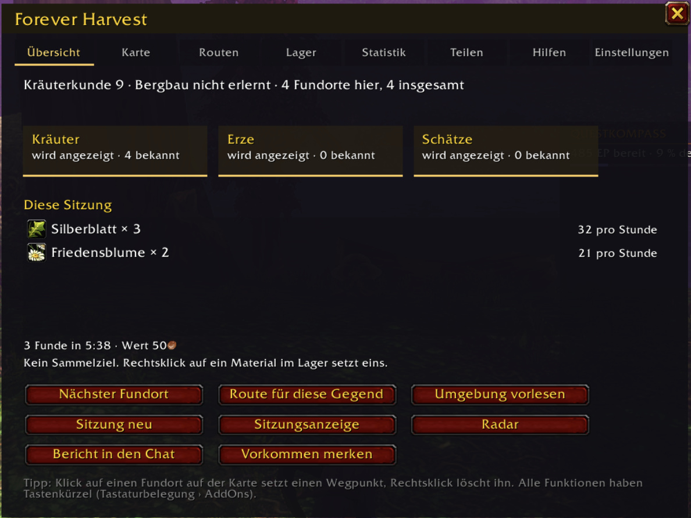
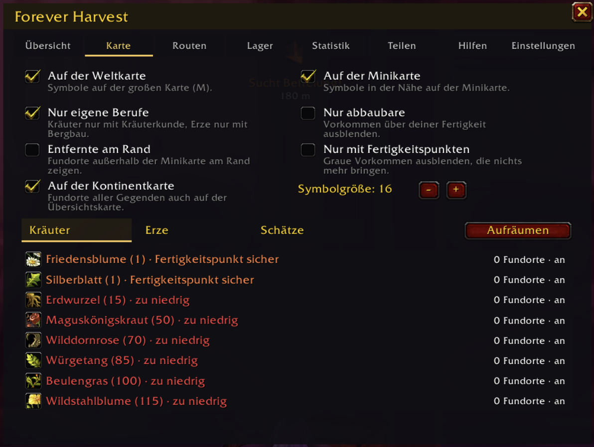
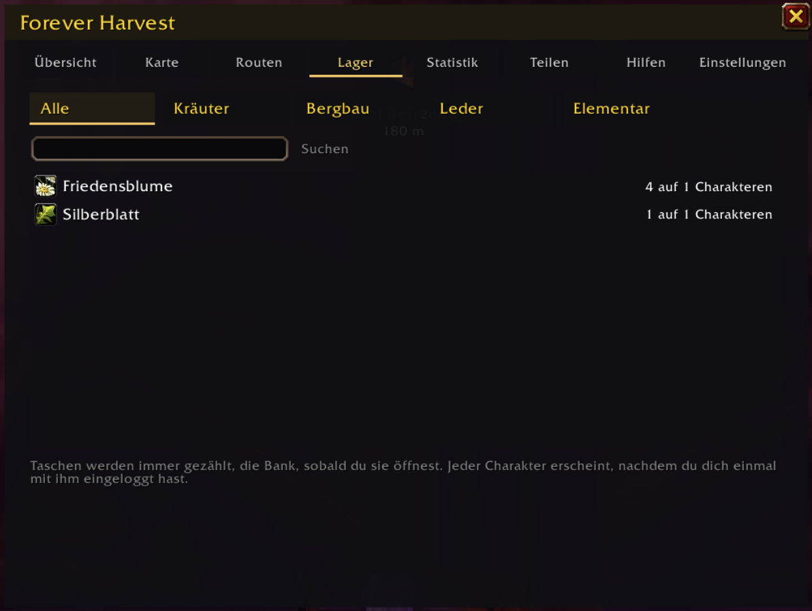
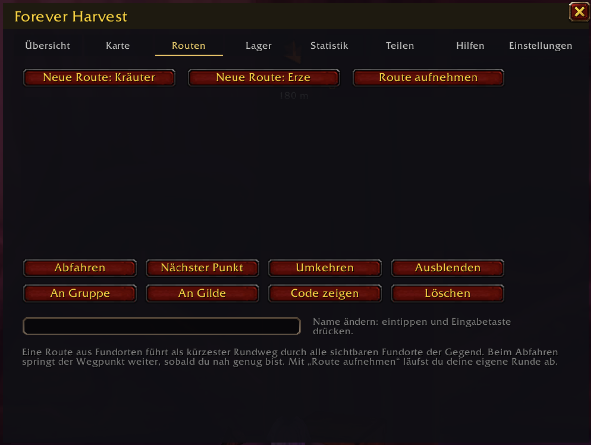
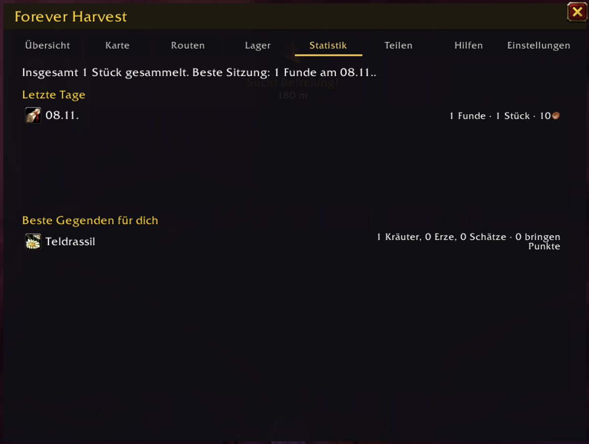
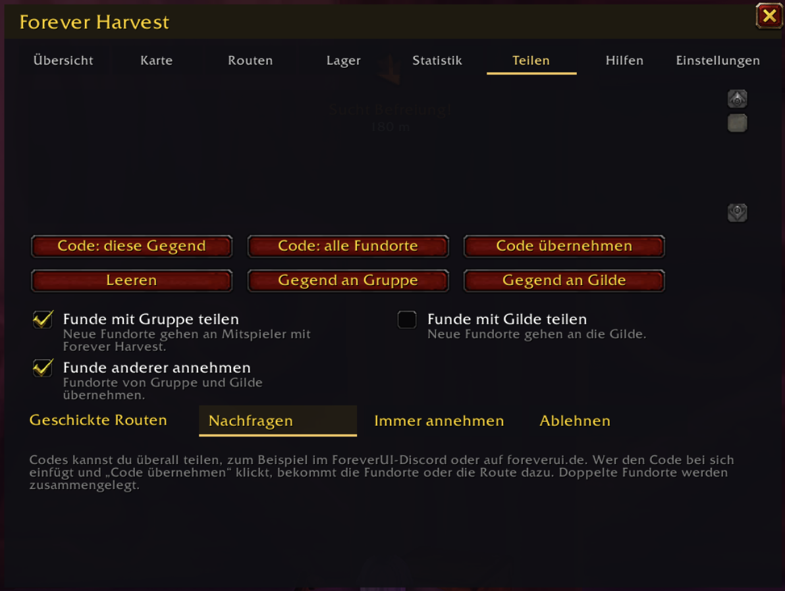
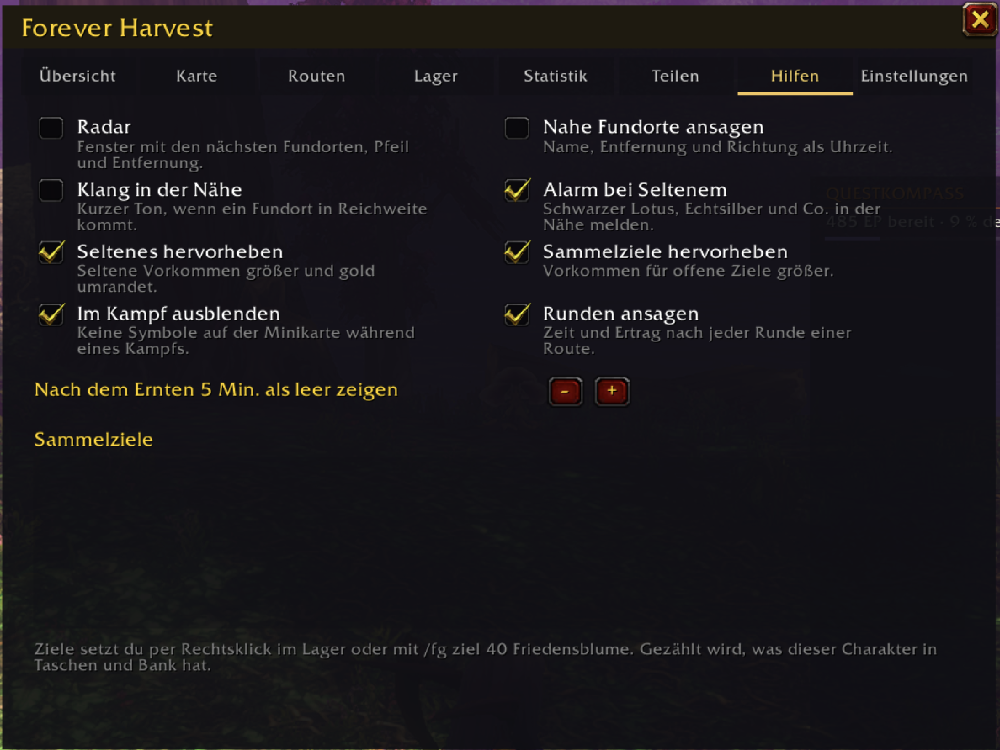
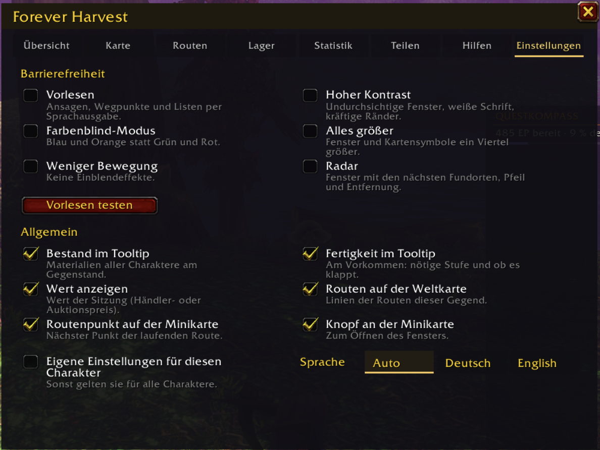

# Forever Harvest

Kräuter, Erze und Schätze auf Welt- und Minikarte für WoW Forever. Teil der ForeverUI-Reihe, mehr auf [foreverui.de](https://foreverui.de/).

## Was es kann

- **Fundorte merken:** Jedes Mal, wenn du ein Kraut pflückst, eine Ader abbaust oder eine Truhe öffnest, merkt sich das Addon den Ort. Kontoweit für alle Charaktere, nahe Funde derselben Sorte werden zusammengelegt.
- **Welt- und Minikarte:** Symbole mit dem Bild des Materials. Klick setzt einen Wegpunkt, Rechtsklick löscht einen Fundort, Umschalt+Rechtsklick blendet die Sorte aus. Vorkommen über deiner Fertigkeit erscheinen blass.
- **Filter:** Kräuter, Erze und Schätze getrennt ein- und ausschalten, jede Sorte einzeln, nur eigene Berufe, nur abbaubare.
- **Fertigkeit im Tooltip:** Am Vorkommen in der Welt siehst du die nötige Stufe und ob du es schon abbauen kannst.
- **Lager aller Charaktere:** Kräuter, Erze, Leder und Elementares aus Taschen und Bank aller Charaktere, im Fenster und im Gegenstands-Tooltip.
- **Farmrouten:** Route aus allen Fundorten einer Gegend (kürzester Rundweg) oder eigene Runde aufnehmen. Beim Abfahren springt der Wegpunkt automatisch zum nächsten Punkt.
- **Teilen:** Neue Funde gehen live an Gruppe oder Gilde. Routen und Fundorte als Code zum Kopieren (Discord, foreverui.de) oder direkt an Gruppe, Gilde oder einen Spieler.
- **Sitzung:** Was du gesammelt hast, Stück pro Stunde und Wert (Händlerpreis oder Auktionspreis, wenn ein Preisaddon installiert ist).
- **Kartenfenster:** kleine, frei verschiebbare Karte der Gegend mit deiner Position, allen Fundorten und der Route als Linie. Mausrad zoomt, Klick auf einen Fundort setzt einen Wegpunkt.
- **Radar und Ziele:** Fenster mit den nächsten Fundorten samt Pfeil, Sammelziele mit Fortschritt, Fertigkeitspunkte in Spielfarben mit Wort, beste Gegenden für deinen Charakter, Statistik der letzten Tage.
- **Seltenes:** Schwarzer Lotus, Silber, Gold und Co. hervorgehoben, Alarm in der Nähe oder wenn die Gruppe eins findet.
- **Barrierefreiheit:** Vorlesen, nahe Fundorte mit Entfernung und Richtung ansagen, hoher Kontrast, Farbenblind-Modus, alles größer, weniger Bewegung, Tastenkürzel für alle Funktionen.

## Bilder

*Übersicht: deine Berufe, bekannte Fundorte und Schnellknöpfe*

*Karte: was angezeigt wird, mit allen Kräutern und Erzen samt Fertigkeitsstufe*

*Lager: Materialien aller Charaktere mit Filter und Suche*

*Routen: erstellen, abfahren und teilen*

*Statistik: die letzten Tage und die besten Gegenden*

*Teilen: Codes und Funde mit Gruppe und Gilde*

*Hilfen: Radar, Alarme und Sammelziele*

*Einstellungen: Barrierefreiheit, Allgemeines und Sprache*

## Befehle

`/fg` öffnet das Fenster, `/fg hilfe` zeigt alle Befehle. Die wichtigsten:

| Befehl | Wirkung |
| --- | --- |
| `/fg naechster` | Wegpunkt zum nächsten Fundort |
| `/fg route neu` | Route aus den Fundorten dieser Gegend |
| `/fg route` | Route starten oder anhalten |
| `/fg aufnahme` | eigene Runde aufnehmen |
| `/fg teilen [route] [gilde \| Name]` | Fundorte oder Route senden |
| `/fg lager [Suche]` | Materialien aller Charaktere |
| `/fg radar` | Radar ein oder aus |
| `/fg karte [Größe]` | Kartenfenster ein oder aus |
| `/fg ziel 40 Friedensblume` | Sammelziel setzen |
| `/fg statistik` | Tage, Gesamtmengen, beste Gegend |
| `/fg vorlesen` | nahe Fundorte vorlesen |
| `/fg diagnose` | technische Infos für Fehlerberichte |

## Erste Schritte

1. Addon installieren und einloggen. Einrichten musst du nichts.
2. Losziehen und sammeln: Jeder Fundort erscheint ab jetzt auf Welt- und Minikarte.
3. Mit `/fg` öffnest du das Fenster mit Übersicht, Karte, Routen, Lager, Statistik, Teilen, Hilfen und Einstellungen.

Fundorte füllen sich durch dein eigenes Sammeln und durch Funde deiner Gruppe, Gilde und geteilte Codes.

## Links

- Webseite: [foreverui.de](https://foreverui.de/)
- Fragen und Ideen: [Discord](https://discord.gg/KFPPhER4Y2)
- Änderungen: siehe CHANGELOG.md

Lizenz: MIT
